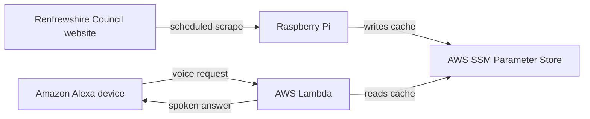

# Renfrew-Yoker Bridge Checker

Check when the **Renfrew-Yoker bridge** is closed by asking **Amazon Alexa**.

Renfrewshire Council publish bridge closure times on their website at the following
page: https://www1.renfrewshire.gov.uk/article/14478/Check-when-Renfrew-Bridge-is-closed-to-vehicles-pedestrians-and-cyclists

---

## Table of Contents

- [How it works](#how-it-works)
- [Requirements](#requirements)
- [Installation](#installation)
- [Running the scrape](#running-the-scrape)
- [Running the tests](#running-the-tests)
- [Tooling](#tooling)
- [Setting up the Raspberry Pi](#setting-up-the-raspberry-pi)
- [Contributing](#contributing)

---

## How it works

A few constraints shaped the design:

- **Renfrewshire council does not publish the required data via an API.** At the time of
  developing this project, there is no API for bridge closure data, only an HTML page,
  so an automated check must scrape it.
- **Alexa allows 8 seconds to respond.** Scraping a live page inside the voice request
  service is too slow and too fragile. Caching the result decouples response latency
  from scrape latency entirely.
- **The Renfrewshire council website sits behind Cloudflare.** Cloudflare answers a
  client with a JavaScript challenge instead of the page unless the connection looks
  like one from a browser, whatever User-Agent header it sends. The scrape uses
  `curl_cffi` to connect with the fingerprint of a real browser, and runs on a Raspberry
  Pi on home broadband rather than in AWS, because requests from datacenter IP ranges
  are still likely to be blocked.
- **A scraping proxy was the first attempt, and it wasn't viable.** ScraperAPI bills 40
  credits per Cloudflare-protected fetch rather than 1, so the free tier ran dry at any
  useful refresh cadence. The Raspberry Pi replaced it and costs virtually nothing to
  run.



A Raspberry Pi on home broadband scrapes the bridge closures page every fifteen minutes
and writes the parsed closures to **AWS SSM Parameter Store** - a managed key-value
store, used here purely as a small, durable cache. The Alexa-facing Lambda only ever
reads that cache.

The scheduled scrape and the voice handler are deliberately kept as separate
deployables. They fail independently: a scrape that breaks leaves the last good cache in
place, and Alexa keeps answering.

---

## Requirements

- [Git](https://git-scm.com/downloads)
- [Python 3.14](https://www.python.org/downloads/)
- A Raspberry Pi that runs the 64-bit Raspberry Pi OS, to run the scrape on a schedule -
  see [Setting up the Raspberry Pi](#setting-up-the-raspberry-pi) for exactly what it
  needs

---

## Installation

```bash
# Clone the repository:
git clone https://github.com/gregor-mcintyre/renfrew-yoker-bridge-checker.git
cd renfrew-yoker-bridge-checker

# Create a virtual environment depending on your operating system:
py -3.14 -m venv .venv # Windows
python3.14 -m venv .venv # macOS/Linux

# Activate the virtual environment depending on your operating system:
.venv\Scripts\activate # Windows
source .venv/bin/activate # macOS/Linux

# Install the project's development dependencies:
pip install -e ".[dev]"

# Wire up git hooks so linting/formatting/type-checks run on every commit:
pre-commit install
```

---

## Running the scrape

The scrape the Raspberry Pi runs on a timer can also be run manually on Windows, macOS
or Linux - it is the same command the Pi's systemd service runs. Each run ends by
writing the closures to AWS.

### 1. Create an AWS account

Sign up at [aws.amazon.com](https://aws.amazon.com/) with **Create an AWS Account**.
It asks for an email address, a password, a payment card and a phone number, and
choose **Basic support – Free** when asked. The email and password you sign up with
are the **root user** - the all-powerful owner of the account - so keep them for account
administration like the steps below, never for the scrape itself.

Two safety nets are worth setting up straight away:

- **Multi-factor authentication (MFA) for the root user** - under your account name at
  the top right, **Security credentials** → **Assign MFA device**.
- **A spending alert** - search the console for **Budgets** and create one from the
  **Zero spend budget** template, which emails you if anything ever starts costing
  money.

### 2. Choose the region

AWS is split into regions - separate groups of data centres - and the cache lives in
exactly one. Use **Europe (Ireland) `eu-west-1`**, the European region Alexa skills run
their Lambda in; the Lambda will read the cache from its own region. Pick it from the
region menu at the top right of the console so you can find the cache later.

### 3. Create a user for the scrape

The scrape should not use your root login. Instead, give it an **IAM user** - a login
for a program, not a person, that is allowed to do one thing only.

1. Open **IAM** → **Users** → **Create user**. Name it
   `renfrew-yoker-bridge-checker-raspberry-pi`, leave console access off, and create it
   without choosing any permissions.
2. On the new user, open **Permissions** → **Add permissions** → **Create inline
   policy**, switch the editor to **JSON**, and paste the policy below. It allows
   writing parameters under `/renfrew-yoker-bridge-checker/` - the prefix of
   `PARAMETER_NAME` in `shared/closure_cache.py` - in Ireland, and nothing else. The `*`
   in place of an account ID grants nothing extra: the user can only ever write
   parameters in the account it belongs to.

   ```json
   {
     "Version": "2012-10-17",
     "Statement": [
       {
         "Effect": "Allow",
         "Action": "ssm:PutParameter",
         "Resource": "arn:aws:ssm:eu-west-1:*:parameter/renfrew-yoker-bridge-checker/*"
       }
     ]
   }
   ```

### 4. Create an access key

An **access key** is the username and password the scrape logs in with. On the user,
open **Security credentials** → **Create access key**, and choose *Application running
outside AWS* as the use case. AWS shows the **secret access key** only once, so keep the
page open until the next step is done - if it is lost, create a new key and delete the
old one. Create one key per machine (a user can hold two) so either can be revoked on
its own, and never commit a key or paste it anywhere else.

### 5. Store the key on your machine

`boto3` reads the key and region from two files in a `.aws` folder in your home
directory - `~/.aws` on macOS/Linux, `%USERPROFILE%\.aws` on Windows. Create the folder,
then the two files with a plain-text editor, with no file extension:

`credentials`, holding the key:

```ini
[default]
aws_access_key_id = <access-key-id>
aws_secret_access_key = <secret-access-key>
```

`config`, holding the region:

```ini
[default]
region = eu-west-1
```

On macOS and Linux, `chmod 600 ~/.aws/credentials` keeps the key readable by you alone.
If the machine already has a `default` profile for other work, name the sections
`[bridge-checker]` in `credentials` and `[profile bridge-checker]` in `config` instead,
and set `AWS_PROFILE` to `bridge-checker` alongside `PYTHONPATH` below.

To check the key works, ask AWS who it is - this needs no permissions, and prints the
user created in step 3:

```bash
python -c "import boto3; print(boto3.client('sts').get_caller_identity()['Arn'])"
```

### 6. Run the scrape

From the repository root, with `.venv` activated:

```bash
# Put the two directories the scrape imports from on the module search path,
# depending on your operating system:
$env:PYTHONPATH = "shared;raspberry_pi" # Windows (PowerShell)
export PYTHONPATH=shared:raspberry_pi # macOS/Linux

# Run the scrape:
python -m bridge_closures
```

There is no need to create the parameter in Parameter Store by hand: the first
successful run creates it, and later runs overwrite it. To see it, open **Systems
Manager** → **Parameter Store** in the console with Ireland selected.

---

## Running the tests

Tests are split into unit, integration and end-to-end tiers. The conventions behind that
split are documented in `tests/CLAUDE.md`, which is also where the canonical commands
live if these drift.

```bash
# The whole test suite:
pytest

# A single tier:
pytest tests/unit
pytest tests/integration
pytest tests/e2e

# A single file:
pytest tests/unit/raspberry_pi/bridge_closures/test_parsing.py

# A single test:
pytest -k test_returns_empty_list_when_no_date_heading_is_found
```

### Test Coverage

Coverage reports show how much of the codebase is exercised by tests. Generate coverage
with `pytest-cov`:

```bash
# Coverage for the whole test suite, printed to the terminal:
pytest --cov

# Coverage with an HTML report (open htmlcov/index.html in a browser):
pytest --cov --cov-report=html

# Coverage for a single tier:
pytest tests/unit --cov
```

---

## Tooling

On every `git commit`, Ruff (lint + format), mypy (type-checking), vulture (dead code),
the test suite and a line-ending check that rejects CRLF run automatically via
pre-commit. mypy, vulture and the tests check the whole repository on every commit, not
just the staged files. Commit with `.venv` activated, since vulture and pytest run from
it. They report issues without auto-fixing. If a hook fails, fix the flagged lines by
hand, then re-commit.

```bash
# Run every hook manually against all files:
pre-commit run --all-files
```

Actual settings live in `pyproject.toml` and `.pre-commit-config.yaml`. See `CLAUDE.md`
for the naming and docstring conventions this project follows, and `tests/CLAUDE.md`
for the testing ones.

---

## Setting up the Raspberry Pi

The Raspberry Pi runs the scrape every fifteen minutes. This section takes a Pi from its
box to a running schedule. Every step ends with a check that proves it worked - don't
move on until it passes. Work through [Running the scrape](#running-the-scrape) on your
own computer first: it creates the AWS account, the region choice and the IAM user this
section relies on.

### What you need

- **A Raspberry Pi that runs the 64-bit Raspberry Pi OS** - a Pi 3, 3B+, 4, 5, 400 or
  Zero 2 W. Older models (Pi 1, 2 and the original Zero) run only the 32-bit OS, which
  won't work: prebuilt Python 3.14 interpreters and the `curl_cffi` library the scrape
  depends on are published for 64-bit ARM (`aarch64`), and building them from source
  on a Pi is impractical.
- **A microSD card of 8 GB or more.**
- **The official power supply for your model.** An underpowered Pi misbehaves in ways
  that look like software faults.
- **Power and home broadband around the clock** - by Wi-Fi or an Ethernet cable. It has
  to be a home connection, not a mobile hotspot or anything in a datacentre - see
  [How it works](#how-it-works) for why the council website's Cloudflare protection
  makes that matter.
- **A computer with an SD card slot or reader** to prepare the card.

### 1. Put Raspberry Pi OS on the card

The Pi has no operating system until you write one to the microSD card.

1. Install **Raspberry Pi Imager** from
   [raspberrypi.com/software](https://www.raspberrypi.com/software/) on your computer,
   and insert the card.
2. In Imager, choose your **device** (e.g. *Raspberry Pi 3*), then the **operating
   system**: *Raspberry Pi OS (other)* → **Raspberry Pi OS Lite (64-bit)**. *Lite* has
   no desktop, which the Pi doesn't need - you control it from your computer. Then
   choose the **storage**: your microSD card.
3. When Imager offers **OS customisation**, accept it and fill in (the settings are
   spread over a few tabs or pages, depending on the Imager version):
    - **Hostname:** `bridge-checker` - the name your computer will find the Pi by.
    - **Username:** **`pi`**, and a password of your choosing. The systemd units in
      [raspberry_pi/systemd](raspberry_pi/systemd) run as `pi` from `/home/pi`; any
      other username means editing the paths in `bridge-checker.service` to match.
    - **Wireless LAN:** your Wi-Fi name and password, with the country set to `GB`. Skip
      this if you'll use an Ethernet cable.
    - **Locale:** time zone `Europe/London`, keyboard layout `gb`.
    - **SSH:** enabled, with password authentication. SSH is how you'll type commands
      on the Pi from your computer.
4. Write the card. Imager erases it, writes the OS and checks it, which takes a few
   minutes.

Put the card in the Pi, connect the network cable if you're using one, and plug in the
power. The first boot takes a couple of minutes while it applies your settings.

**Check:** from a terminal on your computer (PowerShell on Windows, Terminal on
macOS/Linux), connect to the Pi:

```bash
ssh pi@bridge-checker.local
```

Answer `yes` to the question about the host's authenticity (asked only the first time),
then enter the password you chose. A prompt reading `pi@bridge-checker:~ $` means you're
on the Pi. If the name isn't found, look up the Pi's IP address in your router's list
of connected devices and use `ssh pi@<ip-address>` instead.

**From here on, commands run on the Pi** in that SSH session, unless a step says to use
your computer.

### 2. Update the Pi and install Git

```bash
# Bring every installed package up to date:
sudo apt update && sudo apt full-upgrade -y

# Install Git, which Raspberry Pi OS Lite leaves out:
sudo apt install -y git
```

**Check:** confirm the OS is 64-bit and Git is installed:

```bash
uname -m      # prints aarch64 - anything else means the 32-bit OS was written
git --version
```

### 3. Install Python 3.14

Raspberry Pi OS ships an older Python than the project needs. Rather than compile one -
which takes about an hour on a Pi 3 - install [uv](https://docs.astral.sh/uv/), a
Python installer that downloads a prebuilt interpreter:

```bash
# Install uv, then load it into this session (new sessions pick it up automatically):
curl -LsSf https://astral.sh/uv/install.sh | sh
source $HOME/.local/bin/env

# Download Python 3.14:
uv python install 3.14
```

**Check:** `uv python find 3.14` prints the path of the new interpreter.

### 4. Download the project and install its dependencies

```bash
# Clone the repository into /home/pi, where the systemd units expect it:
cd ~
git clone https://github.com/gregor-mcintyre/renfrew-yoker-bridge-checker.git
cd renfrew-yoker-bridge-checker

# Create the virtual environment with Python 3.14:
uv venv --python 3.14 .venv

# Install the libraries the scrape uses. The development tools in `[dev]` aren't needed
# on the Pi, so they're left out:
uv pip install -e .
```

**Check:** the scrape's libraries import under the right Python:

```bash
.venv/bin/python -c "import sys, boto3, bs4, curl_cffi; print(sys.version)"
```

It prints a version starting `3.14`. An `ImportError` means the install step failed -
scroll back through its output for the error.

### 5. Give the Pi its own AWS access key

The Pi signs in to AWS the same way your computer does in
[Running the scrape](#running-the-scrape), but with **its own access key**, so either
can be revoked without affecting the other.

1. On your computer, in the AWS console, create a second access key for the
   `renfrew-yoker-bridge-checker-raspberry-pi` user as in
   [step 4 of Running the scrape](#4-create-an-access-key). Keep the page with the
   secret open until the files below are saved.
2. On the Pi, create the two files from
   [step 5 of Running the scrape](#5-store-the-key-on-your-machine) in `/home/pi/.aws/`,
   using the new key. `nano` is a simple editor that runs in the terminal - save with
   Ctrl+O then Enter, and exit with Ctrl+X:

   ```bash
   mkdir -p ~/.aws
   nano ~/.aws/credentials   # the [default] section with the new key
   nano ~/.aws/config        # the [default] section with region = eu-west-1
   chmod 600 ~/.aws/credentials
   ```

**Check:** ask AWS who the Pi is:

```bash
.venv/bin/python -c "import boto3; print(boto3.client('sts').get_caller_identity()['Arn'])"
```

It prints an ARN ending `:user/renfrew-yoker-bridge-checker-raspberry-pi`.

### 6. Run the scrape once by hand

From `~/renfrew-yoker-bridge-checker`:

```bash
PYTHONPATH=shared:raspberry_pi .venv/bin/python -m bridge_closures
```

It logs the closures it scraped, then the closures it uploaded, and ends without an
error.

**Check:** on your computer, open **Systems Manager** → **Parameter Store** in the AWS
console with Ireland selected, and open `/renfrew-yoker-bridge-checker/closures`. Its
**Last modified date** is the time you just ran the scrape, and the `fetched_at` at the
start of its **Value** matches it.

### 7. Run it on a schedule

The scrape runs as a `oneshot` systemd service driven by a timer - systemd being the
program that starts and supervises everything on the Pi. Both units live in
[raspberry_pi/systemd](raspberry_pi/systemd). From `~/renfrew-yoker-bridge-checker`:

```bash
# Install the units:
sudo cp raspberry_pi/systemd/bridge-checker.{service,timer} /etc/systemd/system/
sudo systemctl daemon-reload

# Enable and start the timer - the service is activated by it, never enabled itself:
sudo systemctl enable --now bridge-checker.timer
```

The timer fires at minutes 0, 15, 30 and 45 of every hour - wall-clock, anchored to the
hour rather than to boot - plus a random delay of up to 60 seconds so the scrape never
hits the council site on the exact quarter. A firing missed while the Pi was off - after
a power cut, say - is caught up shortly after it boots again, and the timer survives
reboots.

The service exits `1` when the council website is unreachable or the cache write fails,
so a bad run shows up in `systemctl status` rather than passing silently. It leaves the
last good cache in place, and Alexa keeps answering from it.

**Check:** confirm the timer is scheduled, then that it runs by itself:

```bash
# NEXT shows the coming quarter-hour:
systemctl list-timers bridge-checker.timer
```

Once that time has passed, look at the outcome of the run:

```bash
# "status=0/SUCCESS" in the output means the last run worked:
systemctl status bridge-checker.service

# The logs of every run, newest last - press q to exit:
journalctl -u bridge-checker.service
```

[Viewing the logs](#viewing-the-logs) covers more ways to read them.

Finally, refresh the parameter in the AWS console: its **Last modified date** has moved
on to the timer's run, with nobody touching it. The Pi is done - it can run without a
screen, keyboard or SSH session from now on.

### Viewing the logs

Every run writes its log to the system journal, which `journalctl` reads. On the Pi, in
an SSH session:

```bash
# The last 50 lines - the usual starting point:
journalctl -u bridge-checker.service -n 50

# Follow new lines as they arrive, until you press Ctrl+C:
journalctl -u bridge-checker.service -f

# Only today's runs, or only the last few hours:
journalctl -u bridge-checker.service --since today
journalctl -u bridge-checker.service --since "3 hours ago"

# Only errors - the failed runs:
journalctl -u bridge-checker.service -p err
```

`journalctl` shows long output a page at a time: press the space bar for the next page
and `q` to quit. Add `--no-pager` to print it all at once instead.

You can also read them without opening a session, by running the command through SSH
from your computer:

```bash
ssh pi@bridge-checker.local journalctl -u bridge-checker.service -n 50 --no-pager
```

A successful run logs two lines - the closures scraped from the council website, then
the closures uploaded to the AWS cache. A failed run logs the reason, then `The
scheduled Renfrew-Yoker bridge closure scrape failed.` and the error. Each line starts
with the time systemd recorded it.

To see whether the logs survive a reboot, list the boots the journal remembers:

```bash
journalctl --list-boots
```

If it lists only the current boot, the journal is kept in memory and a power cut wipes
it. Make it permanent with:

```bash
sudo mkdir -p /var/log/journal
sudo systemctl restart systemd-journald
```

### Keeping it running

**Updating it** - after new commits land on GitHub, on the Pi:

```bash
cd ~/renfrew-yoker-bridge-checker
git pull

# Only needed if pyproject.toml's dependencies changed:
uv pip install -e .

# Only needed if a file in raspberry_pi/systemd changed:
sudo cp raspberry_pi/systemd/bridge-checker.{service,timer} /etc/systemd/system/
sudo systemctl daemon-reload
```

Nothing needs restarting: every run is a fresh process that loads the latest code.

**Troubleshooting** - start with `journalctl -u bridge-checker.service -n 50`, which
shows the last 50 log lines:

| What you see                                                                                                      | What it means                                                                                                                                                                                                             |
|-------------------------------------------------------------------------------------------------------------------|---------------------------------------------------------------------------------------------------------------------------------------------------------------------------------------------------------------------------|
| `Failed to reach the Renfrew-Yoker bridge closures webpage. Status code: 403` with `Just a moment...` in the body | Cloudflare blocked the request. Check the Pi is on home broadband, not a VPN or hotspot. An occasional one that clears by the next run can be ignored.                                                                    |
| `Unable to locate credentials`                                                                                    | The key files aren't in `/home/pi/.aws/` - see step 5. The service runs as `pi`, so a key set up under another user isn't seen.                                                                                           |
| `You must specify a region`                                                                                       | `/home/pi/.aws/config` is missing, or its `region` line is.                                                                                                                                                               |
| `AccessDenied` for `ssm:PutParameter`                                                                             | The IAM policy doesn't cover the parameter - check the policy JSON, and that the region in `config` is `eu-west-1`.                                                                                                       |
| `Signature expired` or certificate errors                                                                         | The Pi's clock is wrong. `timedatectl` should say `System clock synchronized: yes`; the Pi sets its clock over the network, so check the connection.                                                                      |
| `status=203/EXEC` in `systemctl status`                                                                           | systemd can't find `.venv/bin/python` - the repository isn't at `/home/pi/renfrew-yoker-bridge-checker`, or the username isn't `pi`. Edit `bridge-checker.service` to match, then copy it and reload as in *Updating it*. |

---

## Contributing

This project uses the **Git Flow** branching model. See
[CONTRIBUTING.md](CONTRIBUTING.md) for the branch structure, the workflow for features,
bugfixes, releases and hotfixes, and how to get `git-flow` installed.

Code conventions - naming, docstrings and code style - are documented in
[CLAUDE.md](CLAUDE.md), test conventions in [tests/CLAUDE.md](tests/CLAUDE.md), and
commit messages in [CONTRIBUTING.md](CONTRIBUTING.md#commit-messages).
