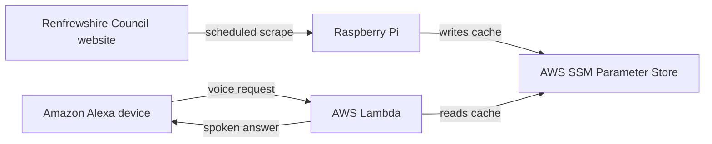

# Renfrew-Yoker Bridge Checker

Check when the **Renfrew-Yoker bridge** is closed by asking **Amazon Alexa**.

Renfrewshire Council publish bridge closure times on their website at the following
page: https://www1.renfrewshire.gov.uk/article/14478/Check-when-Renfrew-Bridge-is-closed-to-vehicles-pedestrians-and-cyclists

---

## Table of Contents

- [How it works](#how-it-works)
- [Requirements](#requirements)
- [Installation](#installation)
- [Running the scrape](#running-the-scrape)
- [Running the tests](#running-the-tests)
- [Tooling](#tooling)
- [Setting up the Raspberry Pi](#setting-up-the-raspberry-pi)
- [Setting up the Alexa skill](#setting-up-the-alexa-skill)
- [Contributing](#contributing)

---

## How it works

A few constraints shaped the design:

- **Renfrewshire council does not publish the required data via an API.** At the time of
  developing this project, there is no API for bridge closure data, only an HTML page,
  so an automated check must scrape it.
- **Alexa allows 8 seconds to respond.** Scraping a live page inside the voice request
  service is too slow and too fragile. Caching the result decouples response latency
  from scrape latency entirely.
- **The Renfrewshire council website sits behind Cloudflare.** Cloudflare answers a
  client with a JavaScript challenge instead of the page unless the connection looks
  like one from a browser, whatever User-Agent header it sends. The scrape uses
  `curl_cffi` to connect with the fingerprint of a real browser, and runs on a Raspberry
  Pi on home broadband rather than in AWS, because requests from datacenter IP ranges
  are still likely to be blocked.
- **A scraping proxy was the first attempt, and it wasn't viable.** ScraperAPI bills 40
  credits per Cloudflare-protected fetch rather than 1, so the free tier ran dry at any
  useful refresh cadence. The Raspberry Pi replaced it and costs virtually nothing to
  run.



A Raspberry Pi on home broadband scrapes the bridge closures page every fifteen minutes
and writes the parsed closures to **AWS SSM Parameter Store** - a managed key-value
store, used here purely as a small, durable cache. The Alexa-facing Lambda only ever
reads that cache.

The scheduled scrape and the voice handler are deliberately kept as separate
deployables. They fail independently: a scrape that breaks leaves the last good cache in
place, and Alexa keeps answering.

---

## Requirements

- [Git](https://git-scm.com/downloads)
- [Python 3.14](https://www.python.org/downloads/)
- A Raspberry Pi that runs the 64-bit Raspberry Pi OS, to run the scrape on a schedule -
  see [Setting up the Raspberry Pi](#setting-up-the-raspberry-pi) for exactly what it
  needs
- Any Alexa device, to ask - see
  [Setting up the Alexa skill](#setting-up-the-alexa-skill)

---

## Installation

```bash
# Clone the repository:
git clone https://github.com/gregor-mcintyre/renfrew-yoker-bridge-checker.git
cd renfrew-yoker-bridge-checker

# Create a virtual environment depending on your operating system:
py -3.14 -m venv .venv # Windows
python3.14 -m venv .venv # macOS/Linux

# Activate the virtual environment depending on your operating system:
.venv\Scripts\activate # Windows
source .venv/bin/activate # macOS/Linux

# Install the project's development dependencies:
pip install -e ".[dev]"

# Wire up git hooks so linting/formatting/type-checks run on every commit:
pre-commit install
```

---

## Running the scrape

The scrape the Raspberry Pi runs on a timer can also be run manually on Windows, macOS
or Linux - it is the same command the Pi's systemd service runs. Each run ends by
writing the closures to AWS.

### 1. Create an AWS account

Sign up at [aws.amazon.com](https://aws.amazon.com/) with **Create an AWS Account**.
It asks for an email address, a password, a payment card and a phone number, and
choose **Basic support – Free** when asked. The email and password you sign up with
are the **root user** - the all-powerful owner of the account - so keep them for account
administration like the steps below, never for the scrape itself.

Two safety nets are worth setting up straight away:

- **Multifactor authentication (MFA) for the root user** - under your account name at
  the top right, **Security credentials** → **Assign MFA device**.
- **A spending alert** - search the console for **Budgets** and create one from the
  **Zero spend budget** template, which emails you if anything ever starts costing
  money.

### 2. Choose the region

AWS is split into regions - separate groups of data centres - and the cache lives in
exactly one. Use **Europe (Ireland) `eu-west-1`**, the European region Alexa skills run
their Lambda in; the Lambda will read the cache from its own region. Pick it from the
region menu at the top right of the console so you can find the cache later.

### 3. Create a user for the scrape

The scrape should not use your root login. Instead, give it an **IAM user** - a login
for a program, not a person, that is allowed to do one thing only.

1. Open **IAM** → **Users** → **Create user**. Name it
   `renfrew-yoker-bridge-checker-raspberry-pi`, leave console access off, and create it
   without choosing any permissions.
2. On the new user, open **Permissions** → **Add permissions** → **Create inline
   policy**, switch the editor to **JSON**, and paste the policy below. It allows
   writing parameters under `/renfrew-yoker-bridge-checker/` - the prefix of
   `PARAMETER_NAME` in `shared/closure_cache.py` - in Ireland, and nothing else. The `*`
   in place of an account ID grants nothing extra: the user can only ever write
   parameters in the account it belongs to.

   ```json
   {
     "Version": "2012-10-17",
     "Statement": [
       {
         "Effect": "Allow",
         "Action": "ssm:PutParameter",
         "Resource": "arn:aws:ssm:eu-west-1:*:parameter/renfrew-yoker-bridge-checker/*"
       }
     ]
   }
   ```

### 4. Create an access key

An **access key** is the username and password the scrape logs in with. On the user,
open **Security credentials** → **Create access key**, and choose *Application running
outside AWS* as the use case. AWS shows the **secret access key** only once, so keep the
page open until the next step is done - if it is lost, create a new key and delete the
old one. Create one key per machine (a user can hold two) so either can be revoked on
its own, and never commit a key or paste it anywhere else.

### 5. Store the key on your machine

`boto3` reads the key and region from two files in a `.aws` folder in your home
directory - `~/.aws` on macOS/Linux, `%USERPROFILE%\.aws` on Windows. Create the folder,
then the two files with a plain-text editor, with no file extension:

`credentials`, holding the key:

```ini
[default]
aws_access_key_id = <access-key-id>
aws_secret_access_key = <secret-access-key>
```

`config`, holding the region:

```ini
[default]
region = eu-west-1
```

On macOS and Linux, `chmod 600 ~/.aws/credentials` keeps the key readable by you alone.
If the machine already has a `default` profile for other work, name the sections
`[bridge-checker]` in `credentials` and `[profile bridge-checker]` in `config` instead,
and set `AWS_PROFILE` to `bridge-checker` alongside `PYTHONPATH` below.

To check the key works, ask AWS who it is - this needs no permissions, and prints the
user created in step 3:

```bash
python -c "import boto3; print(boto3.client('sts').get_caller_identity()['Arn'])"
```

### 6. Run the scrape

From the repository root, with `.venv` activated:

```bash
# Put the two directories the scrape imports from on the module search path,
# depending on your operating system:
$env:PYTHONPATH = "shared;raspberry_pi" # Windows (PowerShell)
export PYTHONPATH=shared:raspberry_pi # macOS/Linux

# Run the scrape:
python -m bridge_closures
```

There is no need to create the parameter in Parameter Store by hand: the first
successful run creates it, and later runs overwrite it. To see it, open **Systems
Manager** → **Parameter Store** in the console with Ireland selected.

---

## Running the tests

Tests are split into unit, integration and end-to-end tiers. The conventions behind that
split are documented in `tests/CLAUDE.md`, which is also where the canonical commands
live if these drift.

```bash
# The whole test suite:
pytest

# A single tier:
pytest tests/unit
pytest tests/integration
pytest tests/e2e

# The live checks against the deployed AWS resources, which the commands above leave
# out - they need credentials, see "Checking it automatically" under "Setting up the
# Alexa skill":
pytest -m live

# A single file:
pytest tests/unit/raspberry_pi/bridge_closures/test_parsing.py

# A single test:
pytest -k test_returns_empty_list_when_no_date_heading_is_found
```

### Test Coverage

Coverage reports show how much of the codebase is exercised by tests. Generate coverage
with `pytest-cov`:

```bash
# Coverage for the whole test suite, printed to the terminal:
pytest --cov

# Coverage with an HTML report (open htmlcov/index.html in a browser):
pytest --cov --cov-report=html

# Coverage for a single tier:
pytest tests/unit --cov
```

---

## Tooling

On every `git commit`, Ruff (lint + format), mypy (type-checking), vulture (dead code),
the test suite and a line-ending check that rejects CRLF run automatically via
pre-commit. mypy, vulture and the tests check the whole repository on every commit, not
just the staged files. Commit with `.venv` activated, since vulture and pytest run from
it. They report issues without auto-fixing. If a hook fails, fix the flagged lines by
hand, then re-commit.

```bash
# Run every hook manually against all files:
pre-commit run --all-files
```

Actual settings live in `pyproject.toml` and `.pre-commit-config.yaml`. See `CLAUDE.md`
for the naming and docstring conventions this project follows, and `tests/CLAUDE.md`
for the testing ones.

---

## Setting up the Raspberry Pi

The Raspberry Pi runs the scrape every fifteen minutes. This section takes a Pi from its
box to a running schedule. Every step ends with a check that proves it worked - don't
move on until it passes. Work through [Running the scrape](#running-the-scrape) on your
own computer first: it creates the AWS account, the region choice and the IAM user this
section relies on.

### What you need

- **A Raspberry Pi that runs the 64-bit Raspberry Pi OS** - a Pi 3, 3B+, 4, 5, 400 or
  Zero 2 W. Older models (Pi 1, 2 and the original Zero) run only the 32-bit OS, which
  won't work: prebuilt Python 3.14 interpreters and the `curl_cffi` library the scrape
  depends on are published for 64-bit ARM (`aarch64`), and building them from source
  on a Pi is impractical.
- **A microSD card of 8 GB or more.**
- **The official power supply for your model.** An underpowered Pi misbehaves in ways
  that look like software faults.
- **Power and home broadband around the clock** - by Wi-Fi or an Ethernet cable. It has
  to be a home connection, not a mobile hotspot or anything in a datacentre - see
  [How it works](#how-it-works) for why the council website's Cloudflare protection
  makes that matter.
- **A computer with an SD card slot or reader** to prepare the card.

### 1. Put Raspberry Pi OS on the card

The Pi has no operating system until you write one to the microSD card.

1. Install **Raspberry Pi Imager** from
   [raspberrypi.com/software](https://www.raspberrypi.com/software/) on your computer,
   and insert the card.
2. In Imager, choose your **device** (e.g. *Raspberry Pi 3*), then the **operating
   system**: *Raspberry Pi OS (other)* → **Raspberry Pi OS Lite (64-bit)**. *Lite* has
   no desktop, which the Pi doesn't need - you control it from your computer. Then
   choose the **storage**: your microSD card.
3. When Imager offers **OS customisation**, accept it and fill in (the settings are
   spread over a few tabs or pages, depending on the Imager version):
    - **Hostname:** `bridge-checker` - the name your computer will find the Pi by.
    - **Username:** **`pi`**, and a password of your choosing. The systemd units in
      [raspberry_pi/systemd](raspberry_pi/systemd) run as `pi` from `/home/pi`; any
      other username means editing the paths in `bridge-checker.service` to match.
    - **Wireless LAN:** your Wi-Fi name and password, with the country set to `GB`. Skip
      this if you'll use an Ethernet cable.
    - **Locale:** time zone `Europe/London`, keyboard layout `gb`.
    - **SSH:** enabled, with password authentication. SSH is how you'll type commands
      on the Pi from your computer.
4. Write the card. Imager erases it, writes the OS and checks it, which takes a few
   minutes.

Put the card in the Pi, connect the network cable if you're using one, and plug in the
power. The first boot takes a couple of minutes while it applies your settings.

**Check:** from a terminal on your computer (PowerShell on Windows, Terminal on
macOS/Linux), connect to the Pi:

```bash
ssh pi@bridge-checker.local
```

Answer `yes` to the question about the host's authenticity (asked only the first time),
then enter the password you chose. A prompt reading `pi@bridge-checker:~ $` means you're
on the Pi. If the name isn't found, look up the Pi's IP address in your router's list
of connected devices and use `ssh pi@<ip-address>` instead.

**From here on, commands run on the Pi** in that SSH session, unless a step says to use
your computer.

### 2. Update the Pi and install Git

```bash
# Bring every installed package up to date:
sudo apt update && sudo apt full-upgrade -y

# Install Git, which Raspberry Pi OS Lite leaves out:
sudo apt install -y git
```

**Check:** confirm the OS is 64-bit and Git is installed:

```bash
uname -m      # prints aarch64 - anything else means the 32-bit OS was written
git --version
```

### 3. Install Python 3.14

Raspberry Pi OS ships an older Python than the project needs. Rather than compile one -
which takes about an hour on a Pi 3 - install [uv](https://docs.astral.sh/uv/), a
Python installer that downloads a prebuilt interpreter:

```bash
# Install uv, then load it into this session (new sessions pick it up automatically):
curl -LsSf https://astral.sh/uv/install.sh | sh
source $HOME/.local/bin/env

# Download Python 3.14:
uv python install 3.14
```

**Check:** `uv python find 3.14` prints the path of the new interpreter.

### 4. Download the project and install its dependencies

```bash
# Clone the repository into /home/pi, where the systemd units expect it:
cd ~
git clone https://github.com/gregor-mcintyre/renfrew-yoker-bridge-checker.git
cd renfrew-yoker-bridge-checker

# Create the virtual environment with Python 3.14:
uv venv --python 3.14 .venv

# Install the libraries the scrape uses. The development tools in `[dev]` aren't needed
# on the Pi, so they're left out:
uv pip install -e .
```

**Check:** the scrape's libraries import under the right Python:

```bash
.venv/bin/python -c "import sys, boto3, bs4, curl_cffi; print(sys.version)"
```

It prints a version starting `3.14`. An `ImportError` means the installation step
failed - scroll back through its output for the error.

### 5. Give the Pi its own AWS access key

The Pi signs in to AWS the same way your computer does in
[Running the scrape](#running-the-scrape), but with **its own access key**, so either
can be revoked without affecting the other.

1. On your computer, in the AWS console, create a second access key for the
   `renfrew-yoker-bridge-checker-raspberry-pi` user as in
   [step 4 of Running the scrape](#4-create-an-access-key). Keep the page with the
   secret open until the files below are saved.
2. On the Pi, create the two files from
   [step 5 of Running the scrape](#5-store-the-key-on-your-machine) in `/home/pi/.aws/`,
   using the new key. `nano` is a simple editor that runs in the terminal - save with
   Ctrl+O then Enter, and exit with Ctrl+X:

   ```bash
   mkdir -p ~/.aws
   nano ~/.aws/credentials   # the [default] section with the new key
   nano ~/.aws/config        # the [default] section with region = eu-west-1
   chmod 600 ~/.aws/credentials
   ```

**Check:** ask AWS who the Pi is:

```bash
.venv/bin/python -c "import boto3; print(boto3.client('sts').get_caller_identity()['Arn'])"
```

It prints an ARN ending `:user/renfrew-yoker-bridge-checker-raspberry-pi`.

### 6. Run the scrape once by hand

From `~/renfrew-yoker-bridge-checker`:

```bash
PYTHONPATH=shared:raspberry_pi .venv/bin/python -m bridge_closures
```

It logs the closures it scraped, then the closures it uploaded, and ends without an
error.

**Check:** on your computer, open **Systems Manager** → **Parameter Store** in the AWS
console with Ireland selected, and open `/renfrew-yoker-bridge-checker/closures`. Its
**Last modified date** is the time you just ran the scrape, and the `fetched_at` at the
start of its **Value** matches it.

### 7. Run it on a schedule

The scrape runs as a `oneshot` systemd service driven by a timer - systemd being the
program that starts and supervises everything on the Pi. Both units live in
[raspberry_pi/systemd](raspberry_pi/systemd). From `~/renfrew-yoker-bridge-checker`:

```bash
# Install the units:
sudo cp raspberry_pi/systemd/bridge-checker.{service,timer} /etc/systemd/system/
sudo systemctl daemon-reload

# Enable and start the timer - the service is activated by it, never enabled itself:
sudo systemctl enable --now bridge-checker.timer
```

The timer fires at minutes 0, 15, 30 and 45 of every hour - wall-clock, anchored to the
hour rather than to boot - plus a random delay of up to 60 seconds so the scrape never
hits the council site on the exact quarter. A firing missed while the Pi was off - after
a power cut, say - is caught up shortly after it boots again, and the timer survives
reboots.

The service exits `1` when the council website is unreachable or the cache write fails,
so a bad run shows up in `systemctl status` rather than passing silently. It leaves the
last good cache in place, and Alexa keeps answering from it.

**Check:** confirm the timer is scheduled, then that it runs by itself:

```bash
# NEXT shows the coming quarter-hour:
systemctl list-timers bridge-checker.timer
```

Once that time has passed, look at the outcome of the run:

```bash
# "status=0/SUCCESS" in the output means the last run worked:
systemctl status bridge-checker.service

# The logs of every run, newest last - press q to exit:
journalctl -u bridge-checker.service
```

[Viewing the logs](#viewing-the-logs) covers more ways to read them.

Finally, refresh the parameter in the AWS console: its **Last modified date** has moved
on to the timer's run, with nobody touching it. The Pi is done - it can run without a
screen, keyboard or SSH session from now on.

### Viewing the logs

Every run writes its log to the system journal, which `journalctl` reads. On the Pi, in
an SSH session:

```bash
# The last 50 lines - the usual starting point:
journalctl -u bridge-checker.service -n 50

# Follow new lines as they arrive, until you press Ctrl+C:
journalctl -u bridge-checker.service -f

# Only today's runs, or only the last few hours:
journalctl -u bridge-checker.service --since today
journalctl -u bridge-checker.service --since "3 hours ago"

# Only errors - the failed runs:
journalctl -u bridge-checker.service -p err
```

`journalctl` shows long output a page at a time: press the space bar for the next page
and `q` to quit. Add `--no-pager` to print it all at once instead.

You can also read them without opening a session, by running the command through SSH
from your computer:

```bash
ssh pi@bridge-checker.local journalctl -u bridge-checker.service -n 50 --no-pager
```

A successful run logs two lines - the closures scraped from the council website, then
the closures uploaded to the AWS cache. A failed run logs the reason, then `The
scheduled Renfrew-Yoker bridge closure scrape failed.` and the error. Each line starts
with the time systemd recorded it.

To see whether the logs survive a reboot, list the boots the journal remembers:

```bash
journalctl --list-boots
```

If it lists only the current boot, the journal is kept in memory and a power cut wipes
it. Make it permanent with:

```bash
sudo mkdir -p /var/log/journal
sudo systemctl restart systemd-journald
```

### Keeping it running

**Updating it** - after new commits land on GitHub, on the Pi:

```bash
cd ~/renfrew-yoker-bridge-checker
git pull

# Only needed if pyproject.toml's dependencies changed:
uv pip install -e .

# Only needed if a file in raspberry_pi/systemd changed:
sudo cp raspberry_pi/systemd/bridge-checker.{service,timer} /etc/systemd/system/
sudo systemctl daemon-reload
```

Nothing needs restarting: every run is a fresh process that loads the latest code.

**Troubleshooting** - start with `journalctl -u bridge-checker.service -n 50`, which
shows the last 50 log lines:

| What you see                                                                                                      | What it means                                                                                                                                                                                                             |
|-------------------------------------------------------------------------------------------------------------------|---------------------------------------------------------------------------------------------------------------------------------------------------------------------------------------------------------------------------|
| `Failed to reach the Renfrew-Yoker bridge closures webpage. Status code: 403` with `Just a moment...` in the body | Cloudflare blocked the request. Check the Pi is on home broadband, not a VPN or hotspot. An occasional one that clears by the next run can be ignored.                                                                    |
| `Unable to locate credentials`                                                                                    | The key files aren't in `/home/pi/.aws/` - see step 5. The service runs as `pi`, so a key set up under another user isn't seen.                                                                                           |
| `You must specify a region`                                                                                       | `/home/pi/.aws/config` is missing, or its `region` line is.                                                                                                                                                               |
| `AccessDenied` for `ssm:PutParameter`                                                                             | The IAM policy doesn't cover the parameter - check the policy JSON, and that the region in `config` is `eu-west-1`.                                                                                                       |
| `Signature expired` or certificate errors                                                                         | The Pi's clock is wrong. `timedatectl` should say `System clock synchronized: yes`; the Pi sets its clock over the network, so check the connection.                                                                      |
| `status=203/EXEC` in `systemctl status`                                                                           | systemd can't find `.venv/bin/python` - the repository isn't at `/home/pi/renfrew-yoker-bridge-checker`, or the username isn't `pi`. Edit `bridge-checker.service` to match, then copy it and reload as in *Updating it*. |

---

## Setting up the Alexa skill

The skill is two parts: an **AWS Lambda function** that reads the cache the scrape
writes and works out what to say, and an **Alexa skill** that turns what you say into a
request to it. Every step ends with a check that proves it worked - don't move on until
it passes.

### Before you start

- **The AWS account, region and cache** from [Running the scrape](#running-the-scrape).
  The cache has to have been written at least once, either by the Raspberry Pi
  ([Setting up the Raspberry Pi](#setting-up-the-raspberry-pi)) or by running the scrape
  by hand on your computer. The skill only trusts a cache written in the last hour, so
  if nothing is scraping on a schedule yet, run the scrape again just before each test
  below. **Check:** in the AWS console, **Systems Manager** → **Parameter Store**,
  with Ireland selected, shows `/renfrew-yoker-bridge-checker/closures` with a recent
  **Last modified date**.
- **An Alexa developer account** - free, and made by signing in at
  [developer.amazon.com/alexa/console/ask](https://developer.amazon.com/alexa/console/ask).
  Sign in with **the same Amazon account your Echo is registered to** - a skill in
  development only appears on the devices of the account that made it. In the Alexa
  app, **More** → **Settings** → **Account Settings** shows which account that is.
- **This repository installed** on your computer, as in [Installation](#installation).

### 1. Build the zip

AWS Lambda runs a zip of the code. From the repository root, with `.venv` activated:

```bash
python alexa_lambda/deployment_zip.py
```

The zip holds the skill, the modules it shares with the scrape, and the `tzdata` package
that gives Python the London time zone. It leaves out `boto3`, which Lambda already
provides.

**Check:** it prints `Wrote` and the path of `build/alexa_lambda.zip`. The `build`
folder is ignored by Git.

### 2. Create the skill

1. In the [Alexa developer console](https://developer.amazon.com/alexa/console/ask),
   choose **Create Skill**.
2. **Skill name:** `Renfrew-Yoker Bridge`. **Primary locale:** *English (UK)*.
3. **Type of experience:** *Other*. **Model:** *Custom*. **Hosting service:** *Provision
   your own*. **Template:** *Start from scratch*. Then **Create skill**.
4. In **Build** → **Interaction Model** → **JSON Editor**, replace everything with
   the contents of
   [alexa_lambda/interaction_model.json](alexa_lambda/interaction_model.json). Choose
   **Save Model**, then **Build Model**.
5. In **Build** → **Endpoint**, copy **Your Skill ID** - it starts `amzn1.ask.skill.`.
   Keep it for step 5.

The invocation name is `renfrew yoker bridge` - Alexa allows only lowercase letters and
spaces there, so it has no hyphen or capitals. It is what you say after "Alexa, open"
or "Alexa, ask".

**Check:** the build finishes with a **Full Build Successful** message, and
**Interaction Model** → **Intents** lists `GetBridgeClosuresIntent`.

### 3. Create the Lambda function

1. In the AWS console, open **Lambda** with Ireland selected - the region has to be the
   one the cache lives in, and one Alexa skills use in Europe.
2. **Create function** → **Author from scratch**. **Function name:**
   `renfrew-yoker-bridge-checker-alexa`. **Runtime:** *Python 3.14*. Leave the rest, and
   **Create function**.
3. On the **Code** tab, choose **Upload from** → **.zip file**, pick
   `build/alexa_lambda.zip`, and **Save**.
4. Still on the **Code** tab, under **Runtime settings**, choose **Edit** and set the
   **Handler** to `bridge_skill.lambda_function.lambda_handler`. Save.
5. On the **Configuration** tab → **General configuration** → **Edit**, set **Memory**
   to `256` MB and **Timeout** to `7` seconds. Alexa gives up after 8
   seconds, so a longer timeout would only be wasted, and `boto3` is slow to load with
   less memory.

**Check:** on the **Test** tab, choose **Create new event**, give it any name, and
replace the body with the following. It is the smallest request Alexa can send, and it
asks the function to describe the bridge closures - so it reaches the cache too, which
will fail with `AccessDeniedException` until step 4 is done:

```json
{"request": {"type": "LaunchRequest"}}
```

Run it. Until step 4 the result is the apology `Sorry, I can't get the Renfrew-Yoker
bridge closures right now.` in `outputSpeech`, and that is the right outcome: the
function loaded, and only the permission is missing.

### 4. Let the function read the cache

The function runs as an **execution role** that step 3 created, which by default can do
nothing but write its own logs.

1. On the **Configuration** tab → **Permissions**, open the role name under **Execution
   role**. It opens in **IAM**.
2. **Add permissions** → **Create inline policy**, switch the editor to **JSON**, and
   paste the policy below. It allows reading the one parameter in Ireland, and nothing
   else.

   ```json
   {
     "Version": "2012-10-17",
     "Statement": [
       {
         "Effect": "Allow",
         "Action": "ssm:GetParameter",
         "Resource": "arn:aws:ssm:eu-west-1:*:parameter/renfrew-yoker-bridge-checker/closures"
       }
     ]
   }
   ```
3. Name it `read-bridge-closures-cache` and create it.

**Check:** run the test event from step 3 again. `outputSpeech` now says whether the
Renfrew-Yoker bridge is open or closed. If it says the site could not be checked
recently, the cache is more than an hour old - run the scrape again first.

### 5. Let only your skill call the function

Without this, nothing - Alexa included - is allowed to call the function.

1. On the function's **Configuration** tab → **Triggers**, choose **Add trigger**.
2. Choose **Alexa** → **Alexa Skills Kit**.
3. Leave **Skill ID verification** on, paste the skill ID from step 2, and **Add**.

**Check:** the trigger is listed on the function, showing your skill ID.

### 6. Point the skill at the function

1. On the function's page, copy its **Function ARN** from the top right - a long name
   starting `arn:aws:lambda:eu-west-1:`.
2. In the Alexa developer console, in **Build** → **Endpoint**, choose **AWS Lambda
   ARN**, paste it into **Default Region**, and **Save**.

**Check:** the save succeeds without an error about the ARN.

### 7. Test in the console

1. In the Alexa developer console, open the **Test** tab and switch **Skill testing is
   enabled in** to *Development*.
2. Type `open renfrew yoker bridge` and press Enter.

**Check:** the skill answers with the same closures as
[the council page](https://www1.renfrewshire.gov.uk/article/14478/Check-when-Renfrew-Bridge-is-closed-to-vehicles-pedestrians-and-cyclists).
Then try `ask renfrew yoker bridge is it closed`. In the **Skill I/O** panel, **JSON
Output** shows the exact response. If it says it couldn't check the council website
recently, the cache is more than an hour old - run the scrape again and retry.

### 8. Try it on your Echo

A skill in development is available only to your own Amazon account, and it has to be
switched on there before any device will answer to it:

1. In the Alexa app, open **More** → **Skills & Games** → **Your Skills** → **Dev**.
2. Choose *Renfrew-Yoker Bridge*, then **Enable**.

Run the scrape again first, as the skill only trusts a cache written in the last hour.
Then say:

- "Alexa, open Renfrew-Yoker Bridge"
- "Alexa, ask Renfrew-Yoker Bridge is it closed"
- "Alexa, ask Renfrew-Yoker Bridge when is it closed"

Alexa's speech recognition doesn't recognise "Yoker", so these spoken phrases may not
reach the skill. [Step 9](#9-short-phrases-with-routines) gets round that: a routine's
action is typed, so you never say it.

**Check:** the Echo answers with the same sentence as in step 7. The skill exists only
in *English (UK)*, so the Echo has to use that language too. If it still can't find
the skill, see the troubleshooting table below.

### 9. Short phrases with routines

Every phrase above starts with the wake word and the name of the skill. A **routine**
in the Alexa app lets you say something much shorter instead, and have Alexa open the
skill for you. Opening it answers straight away, so it is the whole conversation.

1. In the Alexa app, open **More** → **Routines** and tap **+**.
2. **Enter routine name:** `Bridge closures`.
3. Under **When**, choose **Voice** and enter the phrase - `bridge closures` first.
4. Under **Add action**, choose **Custom**, and type `open renfrew yoker bridge`.
5. Choose the Echo under **From**, and **Save**.

Then say "Alexa, bridge closures".

Make a routine for each of the phrases you want, entering the same custom action in
each - or add them all to one routine if the app lets you add more than one phrase:

> bridge closures · bridge times · is the bridge closed · when does the bridge close ·
> is the bridge open · when is the bridge closed · bridge status · check the bridge ·
> can I cross the bridge · Renfrew-Yoker bridge

Amazon offers no way to create routines from code, so this step stays by hand.

**Check:** each phrase gets the closures answered aloud.

### 10. Updating it

After a change to the skill's code, on your computer build the zip again as in step 1,
then in the Lambda console **Code** tab choose **Upload from** → **.zip file** and
**Save**. A change to
[alexa_lambda/interaction_model.json](alexa_lambda/interaction_model.json) is pasted
into the JSON Editor as in step 2, then **Save Model** and **Build Model**.

### 11. Checking it automatically

Two checks in `tests/e2e/alexa_lambda` cover the skill from outside. The first runs
with the rest of the tests, and needs nothing: it builds the zip, unpacks it somewhere
of its own, and calls the function the way AWS does, against a stand-in for the cache.

The second, marked `live`, is left out of `pytest` by default because it uses the real
AWS resources. It runs the scrape itself, so it doesn't depend on a Raspberry Pi being
set up, and checks the cache holds what the scrape just fetched. It then calls the
deployed Lambda function and checks it says whether the bridge is open or closed, which
it only does after reading a cache from the last hour. The test needs to write the
cache, so the scrape runs under your default AWS profile from
[Running the scrape](#running-the-scrape). The rest of the test uses a user of its own
that can only read the cache and call the function:

1. In **IAM** → **Users** → **Create user**, name it
   `renfrew-yoker-bridge-checker-verifier`, leave console access off, and create it
   without choosing any permissions.
2. On it, **Add permissions** → **Create inline policy** → **JSON**, paste the
   policy below, and name it `verify-alexa-skill`:

   ```json
   {
     "Version": "2012-10-17",
     "Statement": [
       {
         "Effect": "Allow",
         "Action": "ssm:GetParameter",
         "Resource": "arn:aws:ssm:eu-west-1:*:parameter/renfrew-yoker-bridge-checker/closures"
       },
       {
         "Effect": "Allow",
         "Action": "lambda:InvokeFunction",
         "Resource": "arn:aws:lambda:eu-west-1:*:function:renfrew-yoker-bridge-checker-alexa"
       }
     ]
   }
   ```
3. On the user, **Security credentials** → **Create access key**, choose *Command Line
   Interface (CLI)* as the use case, and keep the page open until the next step is done.
4. Add the key to `credentials` and `config` under the name
   `bridge-checker-verifier`, as
   [step 5 of Running the scrape](#5-store-the-key-on-your-machine) does for its own
   profile - `[bridge-checker-verifier]` in `credentials` and
   `[profile bridge-checker-verifier]` in `config`, with `region = eu-west-1`.

Then run the live check:

```bash
# Use the verifier's key, depending on your operating system:
$env:AWS_PROFILE = "bridge-checker-verifier" # Windows (PowerShell)
export AWS_PROFILE=bridge-checker-verifier # macOS/Linux

# Only if you named the scrape's profile `bridge-checker` in step 5 of that section,
# say so, as the scrape then has no default profile to run under:
$env:SCRAPE_AWS_PROFILE = "bridge-checker" # Windows (PowerShell)
export SCRAPE_AWS_PROFILE=bridge-checker # macOS/Linux

# Run only the live checks:
pytest -m live
```

**Check:** all the live tests pass. The scrape fetches the council page, so it needs
your internet connection.

### Troubleshooting

When Alexa says there was a problem, start with the function's logs: in the Lambda
console, **Monitor** → **View CloudWatch logs**, and open the newest log stream.

| What you see                                                               | What it means                                                                                                                                                                                       |
|----------------------------------------------------------------------------|-----------------------------------------------------------------------------------------------------------------------------------------------------------------------------------------------------|
| `There was a problem with the requested skill's response`                  | The function failed or ran out of time. Read its logs. If there are none, the trigger in step 5 is missing or has the wrong skill ID, or the ARN in step 6 is wrong.                                |
| `Unable to import module 'bridge_skill.lambda_function'` in the logs       | The handler in step 3 is mistyped, or the zip was built from somewhere other than the repository root.                                                                                              |
| `ZoneInfoNotFoundError` in the logs                                        | The zip has no `tzdata`. Build it again with `.venv` activated, as in step 1.                                                                                                                       |
| `Sorry, I can't get the Renfrew-Yoker bridge closures right now.`          | The function can't read the cache. The log says why: `AccessDeniedException` means the policy in step 4 is missing or names another region, `ParameterNotFound` means nothing has been scraped yet. |
| `I haven't been able to check Renfrewshire Council's website ... recently` | The cache is more than an hour old, so nothing is scraping. Check **Last modified date** on the parameter, and the Pi's logs as in [Viewing the logs](#viewing-the-logs).                           |
| The console test works but the Echo can't find the skill                   | The skill isn't enabled (step 8), the Echo is on another Amazon account, or its language isn't *English (UK)* - check under **Devices** → the Echo → **Settings** → **Language** in the Alexa app.  |
| Alexa doesn't recognise "Yoker"                                            | Use a routine as in step 9, so you never say it.                                                                                                                                                    |

### What it costs

Nothing at this scale. A Lambda function's first million requests a month are free,
standard Parameter Store parameters cost nothing, and an Alexa developer account is
free. The function's logs are the only thing that grows, and by very little. To keep
them from growing at all, in **CloudWatch** → **Log groups**, open
`/aws/lambda/renfrew-yoker-bridge-checker-alexa`, then **Actions** → **Edit retention
setting** and choose *1 week*. The spending alert from
[Running the scrape](#1-create-an-aws-account) covers the rest.

---

## Contributing

This project uses the **Git Flow** branching model. See
[CONTRIBUTING.md](CONTRIBUTING.md) for the branch structure, the workflow for features,
bugfixes, releases and hotfixes, and how to get `git-flow` installed.

Code conventions - naming, docstrings and code style - are documented in
[CLAUDE.md](CLAUDE.md), test conventions in [tests/CLAUDE.md](tests/CLAUDE.md), and
commit messages in [CONTRIBUTING.md](CONTRIBUTING.md#commit-messages).
